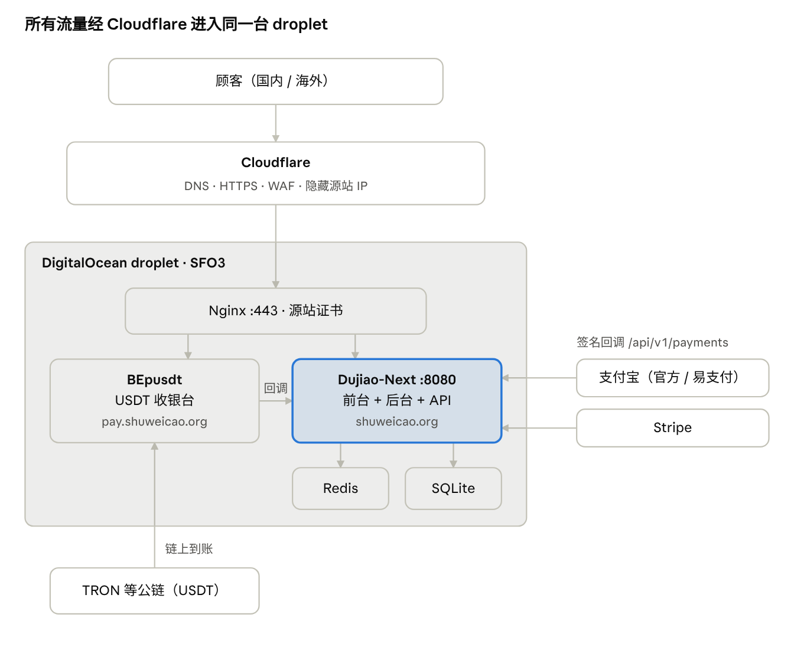

# 技术栈 Spec

> 版本 v1 · 2026-11-19 · 业务需求见 [01-business-spec.md](01-business-spec.md) · 部署见 [03-deployment-guide.md](03-deployment-guide.md)

## 1. 选型结论

**不自研商城，直接用开源的 Dujiao-Next，以 Docker Compose 部署。** 第一阶段只做配置不写代码。Dujiao-Next 已自带推广返佣、钱包、礼品卡、开放 API、分销商（分站）模块；自带功能满足不了时再 fork 源码二次开发。竞品天策也是基于 Dujiao-Next 的 vault 模板做的，拆解见 [04-tiance-teardown.md](04-tiance-teardown.md)。

理由：发卡、库存、订单、查单、后台、支付回调这些 Dujiao-Next 都已内置；它的 8 种支付渠道已经覆盖我们要的支付宝、Stripe、USDT；官方镜像升级和回滚只需改版本号。

## 2. 技术栈

| 层 | 选型 | 说明 |
| --- | --- | --- |
| 商城 | Dujiao-Next（`dujiaonext/dujiao-next` 镜像） | 后端 Go（Gin + GORM），前台和后台都是 Vue 3；一个容器、一个端口（8080）同时提供前台、后台、API |
| 数据库 | SQLite（`/app/db/dujiao.db`） | 官方轻量方案。订单量大了再迁到 PostgreSQL（官方提供 `postgres:16-alpine` 方案） |
| 缓存 / 队列 | Redis 7（`redis:7-alpine`） | 只在 Docker 内部网络，不对外暴露端口 |
| USDT 收款 | BEpusdt（`v03413/bepusdt`） | 自建，监听链上到账后回调商城；只放收款地址，不放私钥 |
| 编排 | Docker Compose | 本地 Mac 和线上服务器用同一份 `stack/docker-compose.yml` |
| 反向代理 | Nginx（宿主机） | 443 端口，Cloudflare 源站证书；把 Cloudflare 传来的真实 IP 还原 |
| 主题网关 | Nginx 容器 `gateway`（`nginx:1.27-alpine`） | 商城前的一层，自动在页面插入 `stack/theme/` 的主题 CSS / JS（天策式外挂，见第 11 节） |
| CDN / DNS / 防护 | Cloudflare 免费版 | DNS、HTTPS、WAF、隐藏源站 IP |
| 服务器 | DigitalOcean Droplet，SFO3，Ubuntu | 建议 1 GB 内存 + 2 GB swap |
| 备份 | sqlite 在线备份 + gpg 加密 + rclone → Cloudflare R2 | 本地 7 天、远端 30 天 |
| 监控 | UptimeRobot + DigitalOcean 告警 | 网站存活 / 内存 / 磁盘 |

## 3. 架构



```
顾客 ──▶ Cloudflare（DNS·HTTPS·WAF）──▶ Nginx :443（宿主机）
                                          ├─ shuweicao.org      ─▶ 127.0.0.1:8080  gateway（插入主题）─▶ dujiao-next ─▶ redis（内部网络）
                                          │                                         └─ SQLite（data/db）
                                          └─ pay.shuweicao.org  ─▶ 127.0.0.1:8090  bepusdt
支付宝 / Stripe ──签名回调──▶ https://shuweicao.org/api/v1/payments/...
TRON 链上到账 ──▶ bepusdt ──回调──▶ dujiao-next
```

- 对公网只开 443（且 ufw 只放行 Cloudflare IP 段）和 22（SSH）
- 所有容器端口都绑定 127.0.0.1，外部无法直连

## 4. 环境

| 环境 | 位置 | 用途 | 域名 | 状态 |
| --- | --- | --- | --- | --- |
| local | 你的 Mac（Docker Desktop） | 技术准备、熟悉后台、试配置 | localhost:8080 | 阶段 0 |
| prod | DigitalOcean SFO3 | 正式海外站 | shuweicao.org / pay.shuweicao.org | 阶段 1 |
| prod-cn | 阿里云或腾讯云中国内地 | 备案后的国内站 + 支付宝官方 | 新的 .com / .cn 域名 | 阶段 4，视营业执照而定 |

暂不单独建测试环境：支付渠道一律先在 prod 用测试模式 / 小额跑通再放开。

## 5. 仓库结构

```
shuweicao/
├── README.md                 总览、路线图、进度
├── docs/
│   ├── 00-local-setup.md     技术准备：Mac 本地运行
│   ├── 01-business-spec.md   业务 spec
│   ├── 02-tech-spec.md       本文
│   ├── 03-deployment-guide.md 部署文档：买什么、去哪接入、怎么上线
│   ├── 04-tiance-teardown.md 竞品拆解
│   ├── architecture.png
│   └── theme-preview.png
├── stack/                    应用栈（本地和线上共用）
│   ├── docker-compose.yml
│   ├── .env.example          → .env（不进 Git）
│   ├── config/               → config.yml（不进 Git）
│   ├── theme/                白色 + 暖黄主题：sw-theme.css、sw-config.js（文案）、sw-home.js、preview.html
│   ├── gateway/              gateway 的 Nginx 配置（插入主题）
│   ├── init.sh               初始化 .env / 目录 / 配置模板
│   ├── backup.sh             加密备份
│   └── upgrade.sh            升级 / 回滚
└── server/                   只在线上服务器用
    ├── 01-server-init.sh     系统、Docker、防火墙、SSH 加固
    ├── 02-deploy-stack.sh    部署 stack 到 /opt/shuweicao
    ├── 03-enable-site.sh     启用 Nginx + HTTPS
    ├── cloudflare-ips.sh     同步 Cloudflare IP（真实 IP + 防火墙）
    └── nginx/shuweicao.conf
```

## 6. 关键配置（config.yml）

| 配置项 | 值 | 说明 |
| --- | --- | --- |
| `app.secret_key` | 随机 64 位十六进制 | 要和数据库一起备份 |
| `jwt.secret` / `user_jwt.secret` | 各自随机，三个密钥互不相同 | 后台 / 用户登录令牌 |
| `web.admin_path` | 随机路径，如 `/m-xxxxxxxxxxxx` | 默认 `/admin` 必须改 |
| 数据库 | SQLite，`/app/db/dujiao.db` | 容器内路径 |
| Redis | host `redis`，port 6379，密码同 `.env` | 容器名即主机名 |
| `bootstrap.default_admin_*` 或 `DJ_DEFAULT_ADMIN_*` | 初始管理员 | 密码留空则首次启动随机生成并打印在日志 |
| `server.mode` | 线上 `release` | |
| `trusted_proxies` | `127.0.0.1`、`172.16.0.0/12` | 商城前有 gateway 容器，需信任 Docker 内网才能拿到顾客真实 IP |
| CORS | 线上只允许 `https://shuweicao.org` | |
| SMTP | 发信服务 | 发卡密邮件 |

健康检查：`GET /health`。

## 7. 支付对接（技术细节）

| 渠道 | Dujiao 渠道类型 | 回调 | 要点 |
| --- | --- | --- | --- |
| USDT | BEpusdt | BEpusdt → 商城回调 | BEpusdt 后台配收款地址 + TronGrid API Key；商城里填 BEpusdt 的地址和 Token |
| Stripe | Stripe | Stripe Webhook → 后台渠道页给出的地址（带 `channel_id`） | 只订阅支付成功 / 失败事件；先 test key 后 live key |
| 支付宝 | 支付宝官方 / 易支付 | `https://shuweicao.org/api/v1/payments/callback` | 官方需营业执照 + 备案域名 |

通用要求：只认签名校验通过的回调；同一订单重复回调不能重复发货（验收必测）；Cloudflare 对 `/api/v1/payments` 路径放行，且 **Bot Fight Mode 保持关闭**（免费版无法对单个路径豁免它）。

## 8. 安全

- ufw：80/443 只放行 Cloudflare IP，22 放行 SSH；容器端口只绑 127.0.0.1
- SSH 仅密钥登录；fail2ban；自动安全更新
- 后台：隐藏路径 + 强密码 + TOTP；可再加 Cloudflare Access
- `.env`、`config.yml`、证书私钥权限 600，不进 Git
- USDT 钱包私钥 / 助记词永不上服务器，定期归集到冷钱包

## 9. 二期开发方式（需要改代码时）

1. Fork `dujiao-next/dujiao-next` 到自己的 GitHub
2. 先确认许可证：官方文档写 MIT，仓库标注 GPL-3.0；若为 GPL，二次开发后对外提供服务需评估开源义务
3. 在 fork 里改代码，用 GitHub Actions 构建自己的镜像推到 GHCR（`ghcr.io/<你>/dujiao-next`）
4. 把 `docker-compose.yml` 里的镜像换成自己的，其余部署流程不变
5. 定期合并上游更新

二期候选功能：首页 / 商品页视觉重做（建议在 `frontend/user/src/templates/` 新增自己的模板）、合伙人等级价 + 累计消费自动升级（若自带分销功能不够）、账号状态检测工具、Codex 重置倒计时。

只改外观时也可以不 fork：像天策那样叠加自定义 CSS / JS。两种方式的优缺点见 [04-tiance-teardown.md](04-tiance-teardown.md)。

## 10. 容量与扩展

- 1 GB 内存可支撑当前四个容器（gateway、dujiao-next、redis、bepusdt）；内存长期超过 80% 再升 2 GB
- 订单量上来后：SQLite → PostgreSQL；备份改为 `pg_dump`
- 国内站上线时：同一套 `stack/` 部署到国内服务器，数据是否共用另行设计（两个站独立运营最简单）

## 11. 主题（白色 + 暖黄，天策式外挂）

| 文件 | 作用 |
| --- | --- |
| `stack/theme/sw-theme.css` | 覆盖 vault 模板的颜色变量（`--bg`、`--red` 主色、`--gold`…），亮色 / 暗色各一套；修正黄底白字；首页区块样式 |
| `stack/theme/sw-config.js` | 首页文案、按钮、付款方式、售后联系方式 —— **日常只改这个** |
| `stack/theme/sw-home.js` | 在首页上方插入标题区 + 查单卡片 + 付款方式，下方插入"怎么购买" + 售后联系；离开首页自动移除 |
| `stack/theme/preview.html` | 不启动系统也能看配色的静态预览 |
| `stack/gateway/default.conf.template` | gateway 用 `sub_filter` 在每个页面 `</head>` 前插入上面三个文件 |

为什么比天策稳：天策替换了官方编译后的页面文件，官方每次升级都要重做；我们只覆盖官方公开的颜色变量，并在首页根节点插入独立区块，官方升级后通常无需改动。

前提：后台「站点设置」里把前台模板切换为 **vault**。

更新主题：改完 `theme/` 下的文件 → `.env` 里 `THEME_VERSION` 加 1 → `docker compose up -d gateway`。
